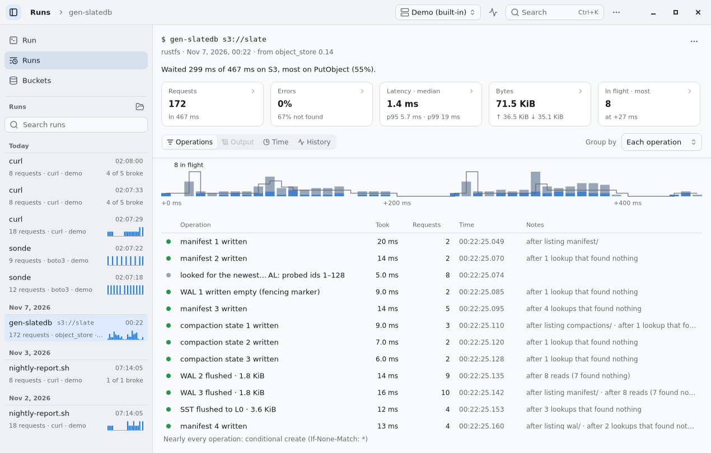
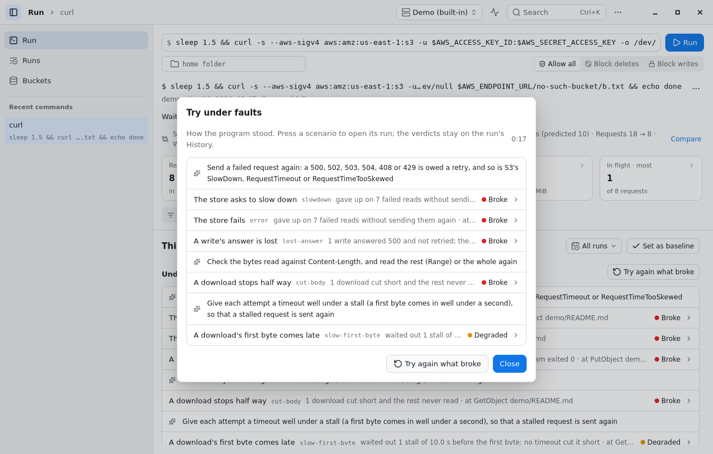
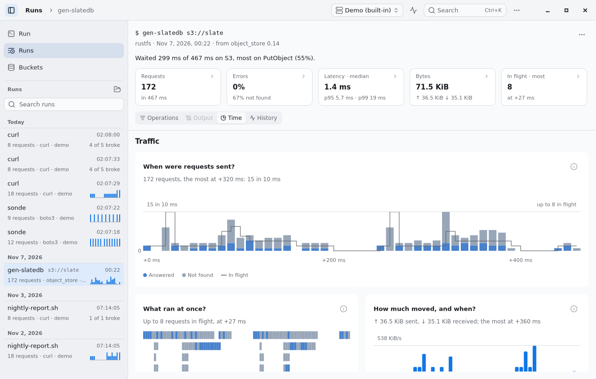
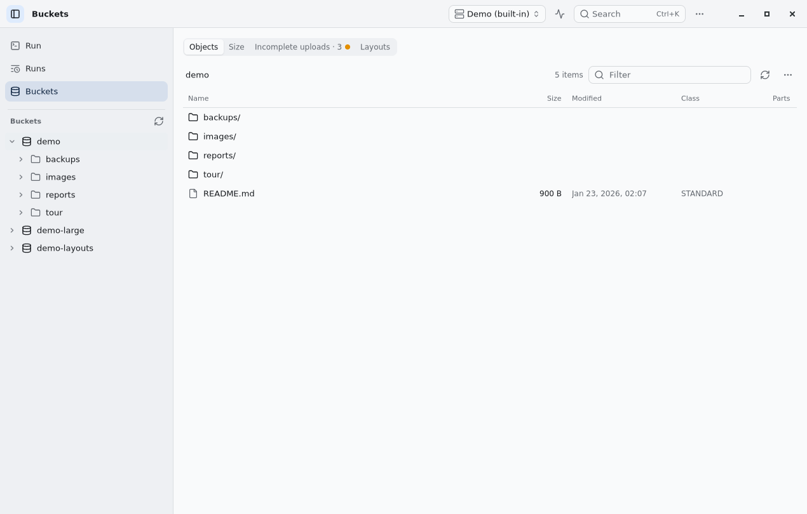

# sonde

sonde shows what your software does to S3. It records a program's object-storage requests through a
local endpoint and reads them as operations: an Iceberg commit, a SlateDB manifest write, a multipart
upload. It is a desktop app built with Native Shell for macOS, Windows and Linux, with a terminal UI
and a CLI alongside.

## What it does

- **Records** every S3 request a program makes with `sonde run -- <command>`.
- **Reads requests as operations**, with counts, errors and latency percentiles per operation.
- **Finds and fixes** hot keys, small files, missing `If-Match`, throttling and more, with the line that sent them.
- **Tries the program under faults** (503s, cut downloads, clock skew) and says whether it survived.

Source code: [github.com/hxddh/sonde](https://github.com/hxddh/sonde)
